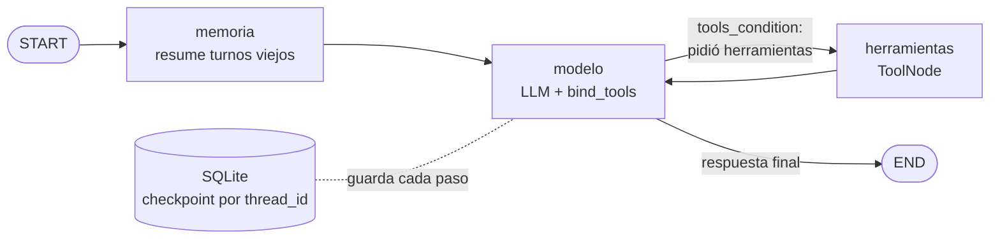

# Agente de razonamiento cíclico con memoria persistente

**Biblio** es un agente ReAct hecho con **LangGraph** que atiende consultas de una biblioteca: disponibilidad de libros, préstamos de cada socio y multas por atraso. El modelo decide solo qué herramienta usar, encadena varias cuando una depende de otra, reintenta cuando una herramienta falla, pide aclaraciones cuando algo es ambiguo y recuerda la conversación entre ejecuciones gracias a un checkpointer **SQLite**.

Python 3.12 · tipado estático (`mypy --strict`) · 100 % asíncrono (`asyncio`).

## Arquitectura



| Pieza | Archivo | Detalle |
|---|---|---|
| Estado | `bibliotecario/estado.py` | `EstadoAgente` (TypedDict) con reducers: `messages` → `add_messages`, `llamadas_herramientas` y `compactaciones` → `operator.add`, `resumen` → se reemplaza |
| Grafo | `bibliotecario/grafo.py` | `StateGraph` con 3 nodos y arista condicional `tools_condition` (modelo ⇄ herramientas) |
| Herramientas | `bibliotecario/herramientas.py` | 4 herramientas propias con `@tool` y docstrings detallados |
| Memoria | `bibliotecario/memoria.py` | nodo que resume el historial cuando supera `UMBRAL_RESUMEN` mensajes |
| Persistencia | `bibliotecario/persistencia.py` | `AsyncSqliteSaver` (variante asíncrona de `SqliteSaver`) |
| Ejecución | `bibliotecario/ejecucion.py` | un turno con `recursion_limit` y cierre limpio si se alcanza |
| Traza | `bibliotecario/traza.py` | registra Pensamiento → Acción → Observación → Respuesta en `.json` y `.log` |

### Por qué `add_messages` y no `operator.add` para los mensajes

`add_messages` concatena igual que `operator.add`, pero además entiende `RemoveMessage`. El nodo `memoria` lo usa para **sacar del estado** los mensajes que ya resumió, así el contexto no crece sin límite ("estado sucio"). Siempre corta justo antes de un mensaje del usuario, de modo que nunca separa una llamada a herramienta de su resultado. El resumen se le pasa al modelo dentro del prompt de sistema.

### Por qué `AsyncSqliteSaver`

Es el `SqliteSaver` del paquete `langgraph-checkpoint-sqlite` en su versión asíncrona (mismo formato de tablas). Como el grafo corre con `astream`, la versión síncrona bloquearía el event loop.

## Herramientas

| Herramienta | Qué hace | Casos de error / información incompleta |
|---|---|---|
| `buscar_libro(consulta)` | Busca por título o autor y devuelve ejemplares disponibles y próxima devolución | Sin resultados → `quizas_quisiste_decir` con títulos parecidos (el agente reintenta) |
| `buscar_socio(nombre)` | Devuelve el `socio_id` a partir del nombre | Varias coincidencias → `ambiguo: true` (el agente pregunta) |
| `prestamos_de_socio(socio_id)` | Libros prestados, vencimiento y días de atraso | Socio inexistente → `error` + `sugerencia` |
| `calcular_multa(socio_id)` | $150 por día de atraso por libro; docentes exentos | Socio inexistente → `error` + `sugerencia` |

Los errores de negocio vuelven al modelo como datos (no como excepciones). Los errores técnicos (por ejemplo, argumentos de tipo inválido) los atrapa `ToolNode(handle_tool_errors=True)` y también vuelven al modelo como `ToolMessage` con `status="error"`. Los datos son simulados (`bibliotecario/catalogo.py`) con una fecha fija (6/11/2026) para que los resultados sean reproducibles.

## Instalación

```bash
git clone https://github.com/ararrojas/agente_de_razonamiento_ciclico_y_memoria_persistente.git
cd agente_de_razonamiento_ciclico_y_memoria_persistente
python3.12 -m venv .venv
source .venv/bin/activate        # Windows: .venv\Scripts\activate
pip install -r requirements.txt
cp .env.example .env             # y completá tu API key (GOOGLE_API_KEY para Gemini)
```

| Variable | Por defecto | Para qué |
|---|---|---|
| `LLM_PROVIDER` | `google` | `google` (Gemini), `anthropic` u `openai` |
| `GOOGLE_API_KEY` / `ANTHROPIC_API_KEY` / `OPENAI_API_KEY` | — | solo la del proveedor elegido |
| `LLM_MODEL` | `gemini-3.8-flash` / `claude-haiku-5-5` / `gpt-4o-mini` | modelo a usar |
| `LLM_RPM` | `0` (sin límite) | solicitudes por minuto al LLM; con el plan gratuito de Gemini usá `4` |
| `RECURSION_LIMIT` | `10` | techo de pasos del grafo por turno |
| `CHECKPOINT_DB` | `data/memoria.sqlite` | base de la memoria persistente |
| `UMBRAL_RESUMEN` | `14` | mensajes a partir de los cuales se resume |
| `TURNOS_A_CONSERVAR` | `2` | turnos recientes que quedan completos |

## Uso

**Demo con traza** (6 turnos + 1 turno después de reabrir la base):

```bash
python -m bibliotecario.demo
```

Sin API key se puede correr con un modelo guionado; las herramientas, el grafo, la memoria y SQLite son los reales:

```bash
python -m bibliotecario.demo --offline
```

**Con el plan gratuito de Gemini** (5 solicitudes por minuto y 20 por día por modelo), limitá la velocidad y resumí la memoria sin LLM para ahorrar llamadas (la demo usa ~15):

```bash
LLM_RPM=4 LLM_MODEL=gemini-3.5-flash-lite python -u -m bibliotecario.demo --resumen-simple
```

La traza se guarda después de cada turno: si la cuota se agota a mitad de camino, queda lo hecho hasta ahí con `"completa": false` y el error en los metadatos.

**Chat interactivo** (el `thread_id` identifica la conversación):

```bash
python -m bibliotecario.chat --thread-id ana --traza
```

**Persistencia entre procesos:**

```bash
python -m bibliotecario.chat --thread-id ana --pregunta "Soy Ana Torres, ¿qué libros tengo?"
```

```bash
python -m bibliotecario.chat --thread-id ana --pregunta "¿Y cuánto debo de multa?"
```

La segunda ejecución es otro proceso, pero sabe que sos Ana (socia 11) porque el historial está en SQLite. Con otro `--thread-id` empieza de cero. Para ver lo que recuerda un thread: `python -m bibliotecario.chat --thread-id ana --historial`.

## Traza ReAct

La demo genera `trazas/traza_react.json` (estructurada) y `trazas/traza_react.log` (legible). La traza incluida se generó con **Gemini real** (`google:gemini-3.5-flash-lite`, ver `metadatos.modelo`): el razonamiento y la elección de herramientas son del modelo, no de un guion. Cada turno demuestra un criterio:

| Turno | Pregunta | Qué muestra |
|---|---|---|
| 1 | ¿Tienen disponible Rayuela? | Autonomía: elige `buscar_libro` solo |
| 2 | Soy Ana Torres. ¿Qué libros tengo prestados? | Encadena `buscar_socio` → `prestamos_de_socio` |
| 3 | ¿Y tengo que pagar alguna multa? | Memoria: usa el socio 11 del turno anterior |
| 4 | ¿Hay algún ejemplar de Cien años de solead? | Ciclo de retorno: error → segundo intento con la sugerencia |
| 5 | Quiero ver los préstamos de Pérez. | Información ambigua → pide aclaración |
| 6 | Camila. | Resuelve la aclaración con el turno anterior |
| 7 | (tras reabrir la base) ¿cuánto era mi multa? | Persistencia + resumen de memoria |

Fragmento del turno 4:

```
[T4 #15] USUARIO      : ¿Hay algún ejemplar de Cien años de solead?
[T4 #16] MEMORIA      : 10 mensajes viejos -> resumen
[T4 #17] ACCIÓN       : buscar_libro(consulta='Cien años de solead')
[T4 #18] OBSERVACIÓN! : buscar_libro -> {"error": "SIN_RESULTADOS", ..., "quizas_quisiste_decir": ["Cien años de soledad"], ...}
[T4 #19] ACCIÓN       : buscar_libro(consulta='Cien años de soledad')
[T4 #20] OBSERVACIÓN  : buscar_libro -> {"cantidad": 1, "resultados": [{"libro_id": "L-02", ..., "disponibles": 2}]}
[T4 #21] RESPUESTA    : Sí, tenemos *Cien años de soledad* de Gabriel García Márquez. De los 3 ejemplares que hay en la biblioteca, **2 están disponibles** ...
```

## Cómo se cumplen los criterios

- **Autonomía:** no hay `if/else` que elija herramientas. El LLM recibe las 4 con `bind_tools` y decide según los docstrings; `tools_condition` solo mira si el mensaje trae `tool_calls`.
- **Ciclo de retorno:** el resultado de cada herramienta vuelve al nodo `modelo`. Con un `error` + sugerencia el agente reintenta; con datos ambiguos o insuficientes, pregunta.
- **Resiliencia de estado:** el checkpointer guarda el estado después de cada nodo, indexado por `thread_id`. Sobrevive a reinicios del proceso.
- **Sin bucles infinitos:** cada invocación lleva `recursion_limit` (10 por defecto). Si se alcanza, el agente responde con un mensaje claro y cierra las llamadas pendientes para que el thread siga siendo usable.
- **Estado limpio:** el nodo `memoria` resume y elimina los turnos viejos cuando el historial supera el umbral.
- **Código limpio:** Python 3.12 (`type`, `match`, `StrEnum`), `mypy --strict` sin errores, `ruff` sin avisos, todo asíncrono.

## Tests

```bash
pip install -r requirements-dev.txt
pytest -q
mypy bibliotecario
ruff check .
```

18 tests, sin llamadas a APIs: docstrings de las herramientas, lógica de negocio, encadenamiento, reintento tras error, argumentos inválidos, memoria con el mismo `thread_id` y tras reabrir la base, aislamiento entre threads, corte por `recursion_limit` y compactación de memoria.

## Estructura

```
├── bibliotecario/
│   ├── catalogo.py       # datos simulados + acceso asíncrono
│   ├── herramientas.py   # @tool
│   ├── estado.py         # EstadoAgente y reducers
│   ├── memoria.py        # resumen del historial
│   ├── grafo.py          # StateGraph + prompt
│   ├── persistencia.py   # checkpointer SQLite
│   ├── ejecucion.py      # turno con recursion_limit
│   ├── traza.py          # traza ReAct (.json / .log)
│   ├── llm.py            # Gemini, Anthropic u OpenAI
│   ├── simulado.py       # modelo guionado (demo offline y tests)
│   ├── demo.py           # demo que genera la traza
│   └── chat.py           # chat por consola
├── tests/
├── trazas/               # traza_react.json + traza_react.log
├── .env.example
├── requirements.txt
└── requirements-dev.txt
```
